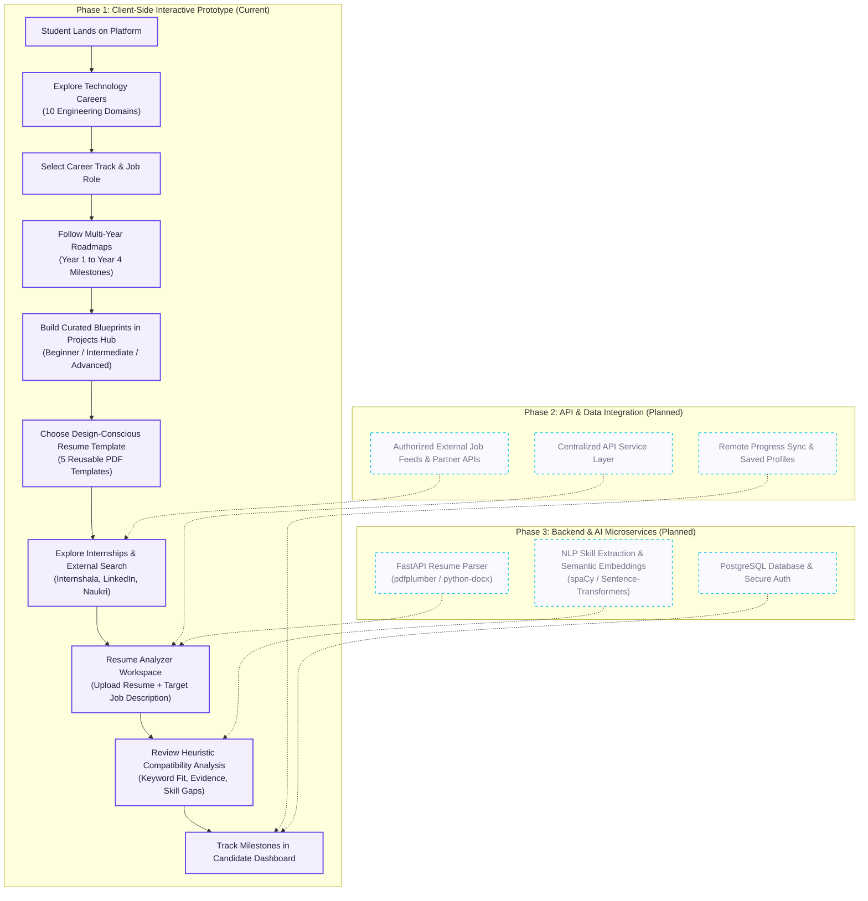

# IntelliMatch — Career Discovery & Readiness Platform

> **Find Your Path. Build Your Future.**  
> An integrated career discovery, learning roadmap, practical project, and resume intelligence platform for engineering students and early-career technology professionals.

[](#project-development-status)
[](#current-frontend-stack)
[](#frontend-architecture)
[](LICENSE)

---

## Table of Contents

1. [Project Overview](#project-overview)
2. [The Original Project Concept & Differentiator](#the-original-project-concept--differentiator)
3. [The Guided Student Journey](#the-guided-student-journey)
4. [Complete Product Workflow](#complete-product-workflow)
5. [Project Development Status (Three-Phase Roadmap)](#project-development-status-three-phase-roadmap)
   - [Phase 1: Frontend Development & Interactive Prototype (Current)](#phase-1--frontend-development--interactive-prototype-current-phase)
   - [Feature Implementation Status Matrix](#feature-implementation-status-matrix)
   - [Phase 2: API Integration & Data Connectivity (Planned)](#phase-2--api-integration--data-connectivity-planned)
   - [Phase 3: Backend Development, Database & AI/NLP Services (Planned)](#phase-3--backend-development-database--ainlp-services-planned)
6. [Core Platform Modules & Pages](#core-platform-modules--pages)
7. [Technology Stack: Current vs. Planned](#technology-stack-current-vs-planned)
8. [Branding & Design System](#branding--design-system)
9. [Resume Templates Library](#resume-templates-library)
10. [Repository Structure](#repository-structure)
11. [Step-by-Step Setup & Running Guide (Windows)](#step-by-step-setup--running-guide-windows)
12. [Troubleshooting Guide](#troubleshooting-guide)
13. [Privacy, Security & Ethical AI Considerations](#privacy-security--ethical-ai-considerations)
14. [Known Limitations & Future Enhancements](#known-limitations--future-enhancements)
15. [License & Acknowledgments](#license--acknowledgments)

---

## Project Overview

**IntelliMatch** is an integrated career discovery and readiness platform designed specifically for engineering students, freshers, and early-career technology learners.

In traditional technical education, career preparation is fragmented across isolated tools:
- Students look up career roles across blogs and career search engines.
- They search for non-linear learning curriculums across scattered repositories.
- They look for practical project ideas and struggle to assess realistic portfolio difficulty.
- They format resumes using unverified templates that often fail automated parsing.
- They apply to internships without understanding role-specific skill gaps or qualification alignment.

IntelliMatch unites these stages into a single, cohesive workflow. The platform helps learners understand the engineering landscape, select a direction, master required competencies, build verifiable portfolio projects, craft clean ATS-conscious resumes, and benchmark their readiness against real-world job postings.

---

## The Original Project Concept & Differentiator

The core differentiator of IntelliMatch is not an unverified claim that any single feature is unprecedented; rather, it is the **educational continuity and unified workflow** that guides students through every milestone of technical readiness:

1. **Domain Exploration** leads directly into **Specialized Role Understanding**.
2. **Role Understanding** determines the recommended **Year-by-Year Learning Roadmap**.
3. **Roadmap Milestones** connect directly to **Practical Projects in the Projects Hub**.
4. **Completed Projects** feed into evidence-backed entries in **ATS-Conscious Resume Templates**.
5. **Prepared Resumes** are evaluated inside the **Resume Analyzer** against target postings.
6. **Identified Skill Gaps** guide the student back to specific roadmap competencies and relevant **Internship Opportunities**.

By treating career preparation as an end-to-end engineering pipeline, IntelliMatch removes the ambiguity students face when transitioning from foundational programming to industry hiring.

---

## The Guided Student Journey

IntelliMatch structures student progress around six continuous stages:

$$\mathbf{Explore} \longrightarrow \mathbf{Choose} \longrightarrow \mathbf{Learn} \longrightarrow \mathbf{Build} \longrightarrow \mathbf{Apply} \longrightarrow \mathbf{Improve}$$

- **Explore:** Discover 10 technical engineering domains and dozens of specialized industry roles.
- **Choose:** Select a target career trajectory (e.g., Software Engineering, Data Science, AI/ML, Cloud/DevOps, Cybersecurity) based on interests and curriculum requirements.
- **Learn:** Follow structured multi-year roadmaps from Year 1 (Foundations) to Year 4 (Career Ready) with semester-by-semester milestones.
- **Build:** Turn theoretical understanding into tangible, portfolio-ready proof by building curated project blueprints with defined deliverables.
- **Apply:** Format credentials using clean, verified ATS-conscious PDF templates and identify relevant student internships or graduate roles.
- **Improve:** Benchmark resume drafts against real job descriptions, analyze keyword coverage and semantic fit, address missing competencies, and track progress over time.

---

## Complete Product Workflow

The diagram below illustrates how a student moves through the platform, mapped to the three development phases:



---

## Project Development Status (Three-Phase Roadmap)

IntelliMatch is an open, actively developed project organized into three sequential development phases.

### Phase 1 — Frontend Development & Interactive Prototype (Current Phase)

Phase 1 establishes the client-side architecture, user interface, design system, interactive models, and static demonstration data. All views are built using standards-compliant HTML5, modular CSS3, and vanilla JavaScript without dependencies on heavy frontend frameworks (no React, Tailwind, or Bootstrap).

#### Key Phase 1 Deliverables (Verified in Repository):
- Complete, responsive single-page and multi-page layouts across 9 core navigation views.
- Centralized data structures for domains (`data/jobRoles.js`), curricula (`data/roadmaps.js`), project blueprints (`data/projects.js`), job opportunities (`data/jobSources.js`), and simulation scenarios (`data/matchingDemo.js`).
- Reusable, accessible component library: connected-ribbon vector logo, responsive sidebar navigation, modal dialogs, tab controls, custom inputs, and KPI cards.
- Fixed-height, continuous flexbox PDF preview modal ensuring complete document visibility without viewport clipping or grey space collapse.
- 5 downloadable, verified PDF resume templates with design-oriented typography and layout structures.
- Local persistence via `localStorage` for roadmap milestones, saved project bookmarks, and user feedback.

---

### Feature Implementation Status Matrix

The table below provides an honest audit of platform capabilities, distinguishing what is fully implemented from client-side demonstrations and future backend features:

| Module / Feature | Location | Scope & Intended Purpose | Implementation Status | Notes / Technical Caveats |
| :--- | :--- | :--- | :--- | :--- |
| **Home Page** | `index.html` | Hero, 4-stage pipeline, 10-domain showcase, roadmap preview, project lab preview, matching simulation. | **Implemented** | Interactive client-side view; links dynamically to dedicated sub-workspaces. |
| **Interactive Matching Demo** | `index.html` / `data/matchingDemo.js` | Demonstrates how keyword coverage, evidence, and semantic fit are scored across 4 preset roles. | **Demo Only** | Illustrative simulation; demonstrates multi-dimensional scoring concepts prior to Phase 3 NLP backend. |
| **Domains & Roadmaps** | `pages/roadmaps.html` / `js/pages/roadmaps.js` | Multi-year engineering curricula (Year 1 to Year 4) across 5 core domains with milestone tasks. | **Implemented** | Includes live concept search, milestone completion checkboxes, progress bar, and `localStorage` persistence. |
| **Projects Hub** | `pages/projects.html` / `js/pages/projects.js` | Real-world engineering project blueprints categorized by domain, prerequisites, difficulty, and deliverables. | **Implemented** | Includes text search, difficulty pills, domain filtering, and project bookmarking (`localStorage`). |
| **Resume Templates Library** | `pages/templates.html` / `js/pages/templates.js` | 5 generic, design-oriented PDF templates with selectable text, clean typography, and verified page counts. | **Implemented** | Full-height flexbox modal viewer (`#view=FitH`), new tab launcher, and direct file downloads without 404s. |
| **Resume Analyzer Workspace** | `pages/analyzer.html` / `js/pages/analyzer.js` | Upload PDF/DOCX resumes, select from 10 domains, paste target job descriptions, calculate match report. | **Demo Only** | File validation and UI flow are functional; parsing and scoring are simulated client-side (backend planned for Phase 3). |
| **Internships & Opportunities** | `pages/internships.html` / `js/pages/internships.js` | Multi-domain benchmark directory, student/full-time filters, live external search launchers, and Analyzer import. | **Implemented** | Searches launch safely in new tabs on official platforms; "Analyze with This Job" transfers data via `sessionStorage`. |
| **Candidate Dashboard** | `pages/dashboard.html` / `js/pages/dashboard.js` | Summary metrics, domain/role filters, recent evaluation records, saved resumes, and fresh empty state toggle. | **Demo Only** | Pre-populated with representative candidate records (Alex Morgan) to evaluate populated vs. empty state layouts. |
| **Feedback Form** | `pages/feedback.html` / `js/pages/feedback.js` | Category selector, 5-star rating, message validation, optional email input, and local submission storage. | **Implemented** | Validates input and persists to `localStorage`; remote database persistence planned for Phase 3. |
| **About Platform** | `pages/about.html` / `js/pages/about.js` | Architecture documentation, target learner profiles, domain coverage, and prototype limitations. | **Implemented** | Complete documentation and transparent prototype scope disclaimers. |

---

### Phase 2 — API Integration & Data Connectivity (Planned)

Phase 2 will introduce an asynchronous communications layer between the frontend interface and remote services:

1. **Centralized API Service Layer:** Introduce modular frontend service clients (`js/services/api.js`) utilizing native JavaScript `fetch()`.
2. **Structured JSON & Multipart Data:** Exchange typed JSON payloads for standard queries; utilize `FormData` for binary PDF and DOCX document uploads.
3. **Explicit Network States:** Implement distinct visual states for all asynchronous operations: `idle`, `loading`, `success`, `empty`, `validation_error`, and `network_failure`.
4. **Authorized External Opportunities:** Integrate authorized partner job boards and internship APIs where permissible by platform terms, replacing open search launch queries with structured listings.
5. **Separation of Concerns:** Keep sample demonstration datasets strictly partitioned from genuine external network responses.
6. **Zero Client Secrets:** Enforce strict security practices—never expose private API keys, client secrets, or administrative credentials inside client-side JavaScript.
7. **Environment-Aware Configuration:** Support dynamic API base URLs configured for local development (`http://127.0.0.1:8000/api`), staging, and production environments.

---

### Phase 3 — Backend Development, Database & AI/NLP Services (Planned)

Phase 3 will build IntelliMatch's dedicated server-side architecture and AI intelligence microservices:

1. **FastAPI Modular Microservices:** Develop a high-performance Python backend powered by FastAPI and Uvicorn.
2. **Strict Schema Validation:** Validate all request payloads, file constraints, and API responses using Pydantic models.
3. **True Resume Document Parsing:** Extract structured text, headers, bullet points, and metadata from uploaded PDF and DOCX documents using libraries such as `pdfplumber` and `python-docx`.
4. **Explainable Resume-to-Job Matching:** Implement multi-dimensional evaluation:
   - *Syntactic Keyword Coverage:* Jaccard similarity and exact phrase matching across required tooling and technologies.
   - *Structural Evidence:* Verification of metric-driven bullet points, project scope, and chronological alignment.
   - *Semantic Proximity:* High-dimensional cosine similarity via lightweight sentence embedding models (e.g., `all-MiniLM-L6-v2` via `sentence-transformers`).
5. **NLP Competency & Skill Extraction:** Identify technical skills, soft proficiencies, and missing competencies using custom tokenizers or `spaCy` entity recognizers.
6. **Relational Database Architecture:** Deploy PostgreSQL with SQLAlchemy ORM and Alembic migrations to securely store user credentials, resume metadata, analysis histories, and completed roadmap checkpoints.
7. **Security & Production Hardening:** Enforce rate-limiting, CORS whitelisting, upload size limits (max 5MB), MIME-type verification, and secure password hashing (`bcrypt`).
8. **Scoring Disclaimers:** Maintain transparency that heuristic and semantic match scores are educational guidelines to assist student preparation, not hiring guarantees.

---

## Core Platform Modules & Pages

The application is structured into 9 dedicated views:

```
├── index.html                  # 1. Home — Platform Landing & Career Journey Overview
└── pages/
    ├── roadmaps.html           # 2. Domains Roadmaps — 5 Multi-Year Curricula (Year 1 to 4)
    ├── projects.html           # 3. Projects Hub — Curated Blueprints (Beginner to Advanced)
    ├── templates.html          # 4. Resume Templates — 5 ATS-Conscious Reusable PDFs
    ├── analyzer.html           # 5. Resume Analyzer — Multi-Domain Evaluation Workspace
    ├── internships.html        # 6. Internships — Opportunities & External Search Launchers
    ├── dashboard.html          # 7. Dashboard — Candidate Metrics & Progress Overview
    ├── feedback.html           # 8. Feedback — User Rating & Suggestion Collection
    └── about.html              # 9. About — Architecture, Domains & Prototype Documentation
```

### 1. Home (`index.html`)
The front door to IntelliMatch. Features a Hero section with three direct call-to-actions, the 4-step Career Readiness pipeline visual, destination path cards, a 10-domain technology directory, live previews for Roadmaps and Projects, an educational 4-scenario job-matching simulation, and prominent readiness tools.

### 2. Domains Roadmaps (`pages/roadmaps.html`)
A structured multi-year curriculum workspace spanning:
- Software Engineering & Full Stack
- Data Analytics & Data Science
- Artificial Intelligence & Machine Learning
- Cloud, DevOps & SRE
- Cybersecurity & InfoSec

Each track provides milestone breakdowns from **Year 1: Foundations** to **Year 4: Career Ready**, detailing technical concepts, required competencies, timeframes, and hands-on capstone tasks with interactive completion checkboxes.

### 3. Projects Hub (`pages/projects.html`)
An engineering blueprint laboratory organizing project specifications by domain and difficulty (Beginner, Intermediate, Advanced). Each project specifies estimated completion hours, concrete deliverables, prerequisites, portfolio impact notes, and skill tags, with a bookmarking feature to save active projects.

### 4. Resume Templates (`pages/templates.html`)
A library of 5 authentic, downloadable PDF resume templates. Differentiates templates based on document layout, hierarchy, and typography rather than restricting them to specific engineering fields. Includes verified page count badges and an inline modal viewer.

### 5. Resume Analyzer (`pages/analyzer.html`)
The core diagnostic workspace. Allows candidates to upload a resume (PDF/DOCX), select their target domain and job role from the 10-domain catalog, and input a job description to calculate skill match breakdowns, missing keywords, and bullet point rewrite suggestions.

### 6. Internships (`pages/internships.html`)
A career discovery portal featuring curated benchmark listings for student internships and entry-level positions. Includes external search query launchers for LinkedIn, Internshala, and Naukri, and allows candidates to transfer any posting into the Resume Analyzer with a single click.

### 7. Dashboard (`pages/dashboard.html`)
A centralized candidate progress center summarizing benchmark evaluations, average compatibility scores, track filters, and saved documents. Includes an interactive toggle between a populated activity view and a fresh empty state.

### 8. Feedback (`pages/feedback.html`)
A structured feedback mechanism supporting bug reporting, feature suggestions, and analysis quality ratings with local browser persistence.

### 9. About (`pages/about.html`)
Detailed reference documentation describing project motivations, engineering domain taxonomies, technology architecture, and current prototype boundaries.

---

## Technology Stack: Current vs. Planned

| Layer | Phase 1: Current Implementation | Phase 2 & 3: Planned Architecture |
| :--- | :--- | :--- |
| **Markup & Structure** | Semantic HTML5 (Custom data attributes, ARIA accessibility) | Semantic HTML5 + Jinja2 (optional SSR) |
| **Styling & Layout** | Native CSS3 (Custom properties, Flexbox, Grid, zero preprocessors) | CSS3 Design Tokens + PostCSS optimization |
| **Client-Side Logic** | Vanilla JavaScript (Native ES6+ Modules, zero bundlers) | Vanilla JS / TypeScript API Service Layer |
| **Document Viewing** | Native Chromium / WebKit PDF Object Viewer (`#view=FitH`) | PDF.js fallback integration for legacy browsers |
| **Local Persistence** | Browser `localStorage` & `sessionStorage` | JWT Cookies + Session Management |
| **Backend & API** | Python `http.server` (Static file serving only) | **Python 3.11+, FastAPI, Uvicorn, REST Endpoints** |
| **Database & ORM** | *None (In-memory mock records & localStorage)* | **PostgreSQL, SQLAlchemy, Alembic Migrations** |
| **Document Extraction** | *None (Client-side size & extension validation only)* | **pdfplumber, python-docx, PyPDF2** |
| **NLP & Matching** | *None (Client-side heuristic string scoring simulation)* | **spaCy, scikit-learn, Sentence-Transformers** |
| **Container & Deploy** | Localhost execution on developer workstation | Docker, Docker Compose, Nginx, Cloud Host |

---

## Branding & Design System

IntelliMatch utilizes a refined, accessible, light-first SaaS aesthetic:

- **Product Name:** IntelliMatch
- **Brand Tagline:** Career Discovery & Readiness
- **Connected-Ribbon Vector Symbol:** The official brand mark consists of an interlocking, continuous ribbon vector with a linear gradient spanning `#4E34C8` (Violet) $\rightarrow$ `#6548E8` (Deep Blue) $\rightarrow$ `#19C6E8` (Cyan).
- **Core Color Tokens:**
  - *Primary Violet:* `#6548E8` (Interactive states, brand highlights, active badges)
  - *Dark Purple:* `#4E34C8` (Hover states, contrast borders)
  - *Accent Cyan:* `#19C6E8` (Terminal gradient accents)
  - *Canvas Background:* `#FAF9FE` (Warm, low-fatigue workspace canvas)
  - *Card Surface:* `#FFFFFF` (High contrast, crisp borders)
  - *Primary Typography:* `#202036` (High-contrast accessible text)
  - *Muted Typography:* `#74748A` (Subtitles, metadata, form hints)
  - *Border Line:* `#E7E5F0` (Restrained structural dividers)
- **Typography:**
  - *Current Implementation:* Headings utilize `Plus Jakarta Sans` with fallback to `Inter`; body copy and interface controls utilize `Inter` and system sans-serif fonts (loaded via Google Fonts).
  - *Design Direction:* `Source Serif 4` is designated as the editorial serif heading direction for future design iterations, with `Roboto` / `Inter` serving body controls.
- **Interface Ergonomics:** All buttons adhere to medium physical heights (44–52px) with 18–24px horizontal padding, preventing cramped mobile targets and avoiding full-width stretches on desktop.

---

## Resume Templates Library

The project includes five authentic, downloadable vector PDF resume templates located in `assets/resume-templates/`. Rather than restricting templates to specific engineering domains, the library categorizes documents by design format and layout hierarchy:

| Template Filename | Document Title | Layout & Typographic Structure | Verified Pages | Recommended Use Case |
| :--- | :--- | :--- | :---: | :--- |
| `clean-professional.pdf` | **Clean Professional** | Restrained margins, modern sans-serif headings, high information density. | 2 Pages | Corporate engineering roles, experienced developers, standard corporate ATS. |
| `experience-focused.pdf` | **Experience-Focused** | Chronological layout prioritizing progressive leadership and professional history. | 2 Pages | Mid-level to senior engineers, career switchers with extensive industry background. |
| `fresher-project-focused.pdf` | **Fresher Project-Focused** | Single-page format with prominent sections for academic credentials and capstones. | 1 Page | College students, fresh graduates, internship applicants with limited work history. |
| `technical-projects.pdf` | **Technical Projects** | Systems-oriented layout highlighting architecture deliverables and tech stacks. | 2 Pages | Full-stack developers, open-source contributors, project-heavy portfolios. |
| `traditional-academic.pdf` | **Traditional Academic** | Classic single-column layout with serif typography and clean section rules. | 1 Page | Research internships, academic admissions, formal engineering firms. |

> [!IMPORTANT]
> **ATS Compatibility & Ethical Template Notice:**  
> These templates are formatted with clean, single- and two-column linear reading orders and selectable vector text. However, no resume template is universally "ATS-certified" or capable of guaranteeing hiring outcomes. Example candidate names and contact details in the sample documents are fictional placeholders; candidates must replace all placeholder data before distributing resumes.

---

## Repository Structure

The actual file tree of the IntelliMatch repository is shown below:

```
IntelliMatch AI/
├── index.html                                 # Platform Home Page
├── favicon.ico                                # Multi-resolution root favicon (16x16, 32x32, 48x48)
├── LICENSE                                    # MIT License file
├── README.md                                  # Platform technical documentation
│
├── assets/
│   ├── favicon-gradient.svg                   # Violet-blue-cyan connected ribbon favicon
│   ├── favicon.svg                            # Root-level SVG favicon alias
│   ├── favicon-32x32.png                      # 32x32 raster favicon fallback
│   ├── apple-touch-icon.png                   # 180x180 iOS touch icon
│   │
│   ├── branding/                              # Official Brand Identity Assets
│   │   ├── favicon-gradient.svg               # Master connected ribbon vector favicon
│   │   ├── favicon.ico                        # Branding directory ICO fallback
│   │   ├── favicon-32x32.png                  # Raster tab icon
│   │   ├── favicon-192x192.png                # High-res PWA icon
│   │   ├── apple-touch-icon.png               # Apple touch icon
│   │   ├── intellimatch-mark.svg              # Gradient vector symbol
│   │   ├── intellimatch-mark-mono.svg         # Monochrome black vector symbol
│   │   ├── intellimatch-mark-gradient.png     # Transparent PNG mark
│   │   ├── intellimatch-logo-horizontal.svg   # Scalable horizontal logo lockup
│   │   └── README.txt                         # Brand asset usage guidelines
│   │
│   └── resume-templates/                      # 5 Verified Reusable Resume PDFs
│       ├── clean-professional.pdf
│       ├── experience-focused.pdf
│       ├── fresher-project-focused.pdf
│       ├── technical-projects.pdf
│       └── traditional-academic.pdf
│
├── css/
│   ├── variables.css                          # Centralized design tokens (colors, radii, typography)
│   ├── base.css                               # CSS reset, box-sizing, and typography defaults
│   ├── layout.css                             # Layout shell: sidebar, top header, content container
│   ├── components.css                         # Buttons, modals, cards, badges, PDF viewer flexbox
│   ├── responsive.css                         # Tablet & mobile drawer navigation breakpoints
│   └── pages/
│       ├── home.css                           # Hero, career paths, directory grids, interactive demo
│       └── platform.css                       # Styles for platform workspaces
│
├── data/
│   ├── jobRoles.js                            # Taxonomy of 10 engineering domains & roles
│   ├── roadmaps.js                            # Multi-year curricula (Year 1 to 4 milestones)
│   ├── projects.js                            # Curated project blueprints (Beginner to Advanced)
│   ├── jobSources.js                          # Benchmark jobs dataset & external search URL templates
│   └── matchingDemo.js                        # 4 simulation scenarios for interactive matching demo
│
├── js/
│   ├── app.js                                 # Main application bootstrapper & page router
│   ├── navigation.js                          # Nav route items, page metadata, root-relative path helpers
│   ├── state.js                               # Reactive sidebar drawer state
│   ├── components/
│   │   ├── sidebar.js                         # Ribbon vector mark, brand text, 9 navigation links
│   │   ├── header.js                          # Top bar, hamburger toggle, contextual action buttons
│   │   ├── footer.js                          # Platform footer, sitemap, disclaimers
│   │   └── icons.js                           # SVG outline icon library
│   ├── pages/
│   │   ├── home.js                            # Home directory filters, roadmap preview, matching demo
│   │   ├── roadmaps.js                        # Domains Roadmaps controller (search, checkboxes, progress)
│   │   ├── projects.js                        # Projects Hub controller (difficulty filter, bookmarks)
│   │   ├── templates.js                       # Templates library (modal PDF preview & download)
│   │   ├── analyzer.js                        # Resume Analyzer workspace & heuristic evaluation
│   │   ├── internships.js                     # Internships portal & external platform search launcher
│   │   ├── dashboard.js                       # Candidate metrics, activity list, empty state toggle
│   │   ├── feedback.js                        # Feedback form validation & rating submission
│   │   ├── about.js                           # Mission & architectural documentation
│   │   └── placeholder.js                     # Fallback empty state handler
│   └── utils/
│       └── dom.js                             # Lightweight DOM helper utilities
│
└── pages/                                     # Dedicated Workspace HTML Entry Points
    ├── roadmaps.html                          # Domains Roadmaps page
    ├── projects.html                          # Projects Hub page
    ├── templates.html                         # Resume Templates library page
    ├── analyzer.html                          # Resume Analyzer page
    ├── internships.html                       # Internships & Opportunities page
    ├── dashboard.html                         # Candidate Dashboard page
    ├── feedback.html                          # Feedback page
    ├── about.html                             # About page
    └── job-search.html                        # Backwards-compatible job search alias
```

---

## Step-by-Step Setup & Running Guide (Windows)

Follow these instructions to run the IntelliMatch Phase 1 prototype on a local Windows machine.

### Prerequisites

- A modern web browser: **Google Chrome**, **Microsoft Edge**, **Mozilla Firefox**, or **Brave**.
- **Python 3.8 or newer**: Verify by running `python --version` or `py --version` in your terminal. (Python is used strictly to provide a local HTTP server for standard ES6 module loading).

---

### Step 1: Open the Project Directory

1. Open **Command Prompt** (`cmd`) or **PowerShell**.
2. Navigate to the root directory where IntelliMatch is located:
   ```powershell
   cd "c:\Users\Lenovo\OneDrive\Desktop\IntelliMatch AI"
   ```
3. Confirm that you are at the project root by running:
   ```powershell
   dir index.html
   ```
   You should see `index.html` listed in the directory output.

---

### Step 2: Start the Local Development Server

Because the application uses native JavaScript modules (`import` / `export`), browsers require files to be served over an HTTP server rather than opened directly via `file://`.

Run the built-in Python HTTP server from the **root directory**:

```powershell
# Using standard Python
python -m http.server 8000

# Or using the Windows Python launcher
py -m http.server 8000
```

You should see output similar to:
```
Serving HTTP on :: port 8000 (http://[::]:8000/) ...
```

---

### Step 3: Open the Application in Your Browser

Open your browser and navigate to:

👉 **`http://127.0.0.1:8000/index.html`**

*(Alternatively, `http://localhost:8000/index.html`)*

> [!NOTE]
> `http://127.0.0.1:8000/` is a local loopback address running solely on your local computer. It is not accessible over the public internet.

---

### Step 4: Stopping the Server

To stop the development server, switch to your PowerShell/terminal window and press:
```
Ctrl + C
```

---

## Troubleshooting Guide

### 1. JavaScript Modules Not Loading / Blank Pages
- **Symptom:** Browser shows a blank layout or console shows `CORS request not HTTP` or `Access to script ... from origin 'null' has been blocked by CORS policy`.
- **Cause:** The project was opened by double-clicking `index.html` as a `file:///` URI. Browsers block ES6 modules over the `file://` protocol for security.
- **Resolution:** Start the Python server as described in Step 2 and access the site via `http://127.0.0.1:8000/index.html`.

### 2. Broken Asset Paths or 404 on Subpages
- **Symptom:** Styles or PDF files fail to load with 404 errors when navigating to `pages/templates.html`.
- **Cause:** The HTTP server was launched from inside a subfolder (e.g., inside `pages/` or `css/`) rather than the repository root.
- **Resolution:** Terminate the server (`Ctrl + C`), `cd` to the root `IntelliMatch AI` directory, and run `python -m http.server 8000` from there.

### 3. Port 8000 Already in Use
- **Symptom:** `OSError: [WinError 10048] Only one usage of each socket address is normally permitted`.
- **Cause:** Another process or previous Python instance is already using port 8000.
- **Resolution:** Start the server on an alternate port:
  ```powershell
  python -m http.server 8080
  ```
  Then visit `http://127.0.0.1:8080/index.html`.

### 4. Browser Tab Displays a Generic Globe Instead of the Logo
- **Symptom:** The browser tab displays a grey globe icon instead of the gradient ribbon favicon.
- **Cause:** Chromium caches 404 favicon states persistently in its internal database.
- **Resolution:**
  1. Open a new tab and visit `http://127.0.0.1:8000/assets/branding/favicon-gradient.svg` directly.
  2. Press `Ctrl + F5` to force the browser to cache the SVG.
  3. Return to `http://127.0.0.1:8000/index.html` and hard-refresh with `Ctrl + F5`.
  4. Alternatively, open an Incognito / InPrivate window (`Ctrl + Shift + N`).

---

## Privacy, Security & Ethical AI Considerations

1. **Client-Side Data Privacy (Phase 1):** In the current prototype phase, all uploaded resumes (PDF/DOCX) are parsed and held solely in volatile browser memory. No documents, personal contact details, or resume files are transmitted over the internet or saved to remote databases.
2. **Zero Hardcoded Secrets:** No third-party API keys, bearer tokens, or cloud service credentials are embedded in client-side code.
3. **Scoring Transparency & AI Ethics:**
   - Compatibility percentages, skill matches, and writing suggestions generated by the prototype are educational heuristic estimations.
   - Match scores do not guarantee that a candidate will pass any employer's automated Applicant Tracking System (ATS), receive an interview invitation, or secure employment.
   - Algorithms must never be used as discriminatory filters; their purpose in IntelliMatch is to provide formative educational feedback to help students learn and improve.

---

## Known Limitations & Future Enhancements

### Known Limitations in Phase 1
- **Simulated Parsing:** The Resume Analyzer currently validates document size and type on the client, but deep text extraction and skill matching rely on demonstration rules rather than a live Python NLP service.
- **Local Persistence Only:** Roadmap milestones and bookmarked projects persist via browser `localStorage`. Clearing browser data resets these records.
- **External Search Launchers:** The Internships module launches verified search queries on external platforms (LinkedIn, Naukri, Internshala) rather than ingesting live synchronized job feeds.

### Planned Future Enhancements (Phases 2 & 3)
- [ ] Connect the centralized frontend API client (`js/services/api.js`) to a FastAPI microservice backend.
- [ ] Implement true server-side PDF and DOCX text extraction with layout awareness.
- [ ] Introduce semantic text embeddings using lightweight transformer models for context-aware qualification matching.
- [ ] Deploy a PostgreSQL database for multi-device user account authentication and progress synchronization.
- [ ] Integrate authorized job-board partner APIs with automated application tracking.
- [ ] Implement automated GitHub repository verification for completed Projects Hub deliverables.

---

## License & Acknowledgments

This project is licensed under the **MIT License** — see the [LICENSE](LICENSE) file for details.

```
MIT License

Copyright (c) 2026 Thejas K S

Permission is hereby granted, free of charge, to any person obtaining a copy
of this software and associated documentation files (the "Software"), to deal
in the Software without restriction, including without limitation the rights
to use, copy, modify, merge, publish, distribute, sublicense, and/or sell
copies of the Software, and to permit persons to whom the Software is
furnished to do so, subject to the following conditions:
...
```

Developed as an educational career guidance initiative to help engineering students bridge the gap between academic study and professional readiness.
